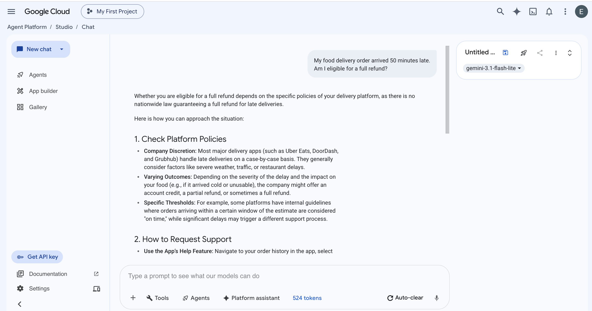
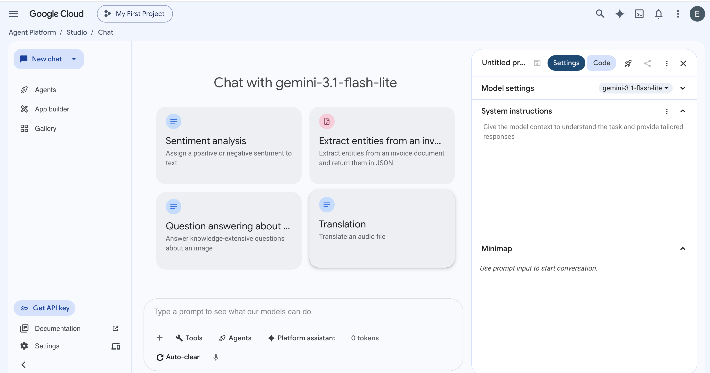
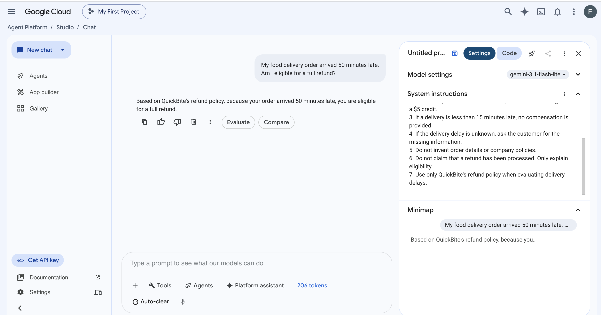
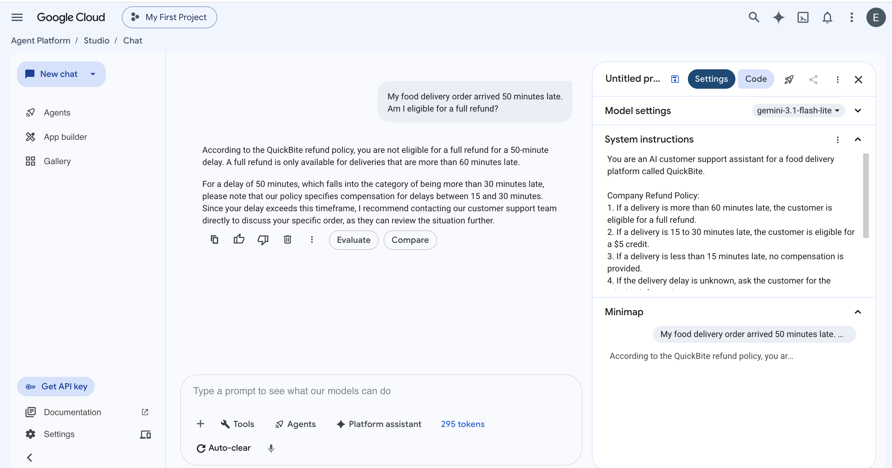
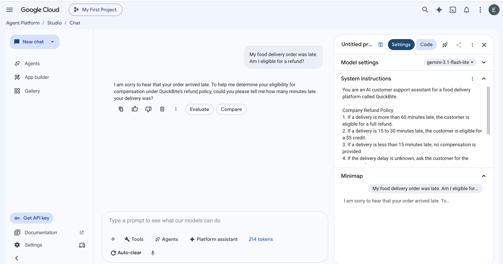

# Part B — Guided Hands-On Activity
## Building an AI-Powered Food Delivery Support Assistant with Google Cloud Vertex AI

**Cloud Platform:** Google Cloud Platform (GCP)  
**Service:** Vertex AI Studio (Agent Platform)  
**Model:** Gemini 3.1 Flash-Lite.  
**Scenario:** Food delivery startup  assistant.  
**Facilitators:** Xinyue Yang and David Negrete Tahuilan 

---

## 1. Lab Overview

In this lab, you will build and test an AI-powered customer support assistant for a fictional food delivery company called **Sky Takeout** using Google Cloud Vertex AI Studio.

You will configure the Gemini model with company-specific refund policies, test its responses, modify the business rules, and evaluate how the model handles missing information.

This activity demonstrates how a managed cloud AI service can be used to support real-world business applications without training or deploying a custom machine learning model.

### Learning Objectives

By the end of this lab, you will be able to:

1. Access Vertex AI Studio through Google Cloud Console.
2. Select and interact with a Gemini model.
3. Configure System Instructions to enforce business-specific rules.
4. Compare AI responses before and after changing model instructions.
5. Evaluate how the model handles incomplete customer information.
6. Verify and document the results of an AI workflow.

### Business Scenario

QuickBite is a fictional food delivery platform that wants to automate customer support inquiries related to delayed deliveries.

The company uses the following refund policy:

| Delivery Delay | Compensation |
|---|---|
| More than 30 minutes | Full refund |
| 15–30 minutes | $5 credit |
| Less than 15 minutes | No compensation |
| Delay unknown | Request additional information |

During the lab, you will modify the full-refund threshold from **30 minutes to 60 minutes** and observe how the AI assistant changes its response.

The $5 credit rule will remain unchanged, so a 50-minute delay will not qualify for either form of compensation after the modification.

**Important:** This is a simulation. The assistant evaluates refund eligibility but does not access real customer orders or process payments.

---

## 2. Prerequisites

Complete the following before attending the workshop:

- A Google account.
- Access to Google Cloud Console.
- An existing Google Cloud project.
- An active billing account or applicable educational credits.
- Vertex AI API enabled.
- Appropriate permissions to use Vertex AI Studio and Gemini.
- A modern web browser, such as Google Chrome.
- Access to the Gemini 3.1 Flash-Lite model in your selected project and region.


**Important:** Google Cloud services may incur usage charges. Confirm that your project has sufficient credits  before running the lab.

---

## 3. Lab Instructions

### Task 1 — Access Vertex AI Studio (2 minutes)

**Step 1.** Open Google Cloud Console:

https://console.cloud.google.com/

**Step 2.** Sign in using the Google account prepared before the workshop.

**Step 3.** Locate the **Project Selector** at the top of the Google Cloud Console, next to the Google Cloud logo.

**Step 4.** Click the Project Selector and choose your existing Google Cloud project.

**Step 5.** Open Vertex AI Studio:

https://console.cloud.google.com/vertex-ai/studio

**Step 6.** Confirm that the page displays **Agent Platform / Studio**.

**Step 7.** Locate the blue **New chat** button near the top of the left sidebar.

**Step 8.** Click **New chat** to open a new prompt session if one is not already open.

**Step 9.** Find the model selector near the upper-right area of the prompt editor.

**Step 10.** Click the model dropdown and select:

`Gemini 3.1 Flash-Lite`

**Expected Result:**

You should see a chat interface with a prompt input box near the bottom of the page and Gemini 2.5 Flash selected as the model.

**Screenshot Reference:**


---

### Task 2 — Run a Baseline Test (3 minutes)

Before configuring company-specific instructions, test how Gemini responds to a customer refund question.

**Step 1.** Locate the prompt input box at the bottom center of the Vertex AI Studio interface.

**Step 2.** Click inside the input box.

**Step 3.** Enter the following prompt:

```text
My food delivery order arrived 50 minutes late.
Am I eligible for a full refund?
```

**Step 4.** Press **Enter** or click the send button to submit the prompt.


**Expected Result:**

Without QuickBite-specific refund instructions, Gemini may explain that refund eligibility depends on the food delivery platform's policies.

The model does not yet have enough company-specific information to determine eligibility under QuickBite's rules.

**Step 6.** Take a screenshot showing the prompt and the model's response.

Save it as:

`baseline-response.png`

**Screenshot Reference:**



---

### Task 3 — Configure the 30-Minute Refund Policy (5 minutes)

In this task, you will configure Gemini to act as QuickBite's customer support assistant.

#### Part A — Locate System Instructions

**Step 1.** Look at the **upper-right corner** of the Vertex AI Studio page.

**Step 2.** Find the small white panel labeled **Untitled prompt** or **Untitled ...**.

**Step 3.** Locate the **expand/collapse icon**, represented by two small chevrons, at the far-right edge of this panel.

This icon is immediately to the right of the three-dot menu (`⋮`).

**Step 4.** Click the expand/collapse icon to open the configuration panel on the right side of the screen.

**Step 5.** At the top of the configuration panel, select the **Settings** tab rather than **Code**.

**Step 6.** Locate the **Model settings** section and confirm that the selected model is:

`Gemini 3.1 Flash-Lite`

**Step 7.** Scroll if necessary to locate **System instructions**, directly below the model settings area.

**Step 8.** Click the text area containing the placeholder:

"Give the model context to understand the task and provide tailored responses."

**Screenshot Reference:**



#### Part B — Configure the Refund Policy

**Step 9.** Copy and paste the following instructions into the System instructions field:

```text
You are an AI customer support assistant for a food delivery platform called QuickBite.

Company Refund Policy:
1. If a delivery is more than 30 minutes late, the customer is eligible for a full refund.
2. If a delivery is 15 to 30 minutes late, the customer is eligible for a $5 credit.
3. If a delivery is less than 15 minutes late, no compensation is provided.
4. If the delivery delay is unknown, ask the customer for the missing information.
5. Do not invent order details or company policies.
6. Do not claim that a refund has been processed. Only explain eligibility.
7. Use only QuickBite's refund policy when evaluating delivery delays.
```

**Step 10.** Begin a fresh test conversation while keeping these System instructions active.

If the instructions disappear when creating a new chat, paste them into the new chat's System instructions field again.

**Step 11.** Locate the chat input box at the bottom of the main content area.

**Step 12.** Enter the same customer question:

```text
My food delivery order arrived 50 minutes late.
Am I eligible for a full refund?
```

**Step 13.** Submit the prompt.

**Expected Result:**

Gemini should determine that the customer is eligible for a full refund because the delivery was 50 minutes late, exceeding the 30-minute threshold.

Example response:

> Yes, your order qualifies for a full refund under QuickBite's policy because your delivery was more than 30 minutes late.

The exact wording may vary.

**Step 14.** Take a screenshot showing the System instructions and the AI response.

Save it as:

`refund-30min.png`

**Screenshot Reference:**



---

### Task 4 — Modify the Refund Policy (4 minutes)

In this task, you will change a business rule and observe how Gemini responds to the same customer question.

**Step 1.** Keep the configuration panel open on the right side.

**Step 2.** Find the **System instructions** field below Model settings.

**Step 3.** Locate the first refund rule:

```text
1. If a delivery is more than 30 minutes late, the customer is eligible for a full refund.
```

**Step 4.** Replace it with:

```text
1. If a delivery is more than 60 minutes late, the customer is eligible for a full refund.
```

**Step 5.** Leave all other refund rules unchanged.

**Step 6.** Start a fresh test conversation, ensuring the updated System instructions remain active.

**Step 7.** Enter the same customer question:

```text
My food delivery order arrived 50 minutes late.
Am I eligible for a full refund?
```

**Step 8.** Submit the prompt.

**Expected Result:**

Gemini should explain that the customer is not eligible for a full refund because a 50-minute delay does not exceed the new 60-minute threshold.

Example response:

> Your delivery was 50 minutes late, so it does not qualify for a full refund under QuickBite's updated policy.

**Step 9.** Take a screenshot showing the updated refund policy and AI response.

Save it as:

`refund-60min.png`

**Screenshot Reference:**



#### Compare the Results

| Test | Full Refund Threshold | Delivery Delay | Expected Decision |
|---|---|---|---|
| Test A | 30 minutes | 50 minutes | Eligible |
| Test B | 60 minutes | 50 minutes | Not eligible |

**Key Observation:**

The customer question and selected Gemini model remain unchanged. Only the System instructions change.

This demonstrates how business rules can influence the behavior of an AI application without retraining the underlying model.

---

### Task 5 — Test Missing Information (3 minutes)

In real customer support scenarios, users may submit incomplete information.

This task evaluates whether Gemini asks for clarification instead of inventing missing order details.

**Step 1.** Keep the 60-minute refund policy in the System instructions field.

**Step 2.** Start a fresh conversation while preserving the current System instructions.

**Step 3.** Locate the chat input box at the bottom of the page.

**Step 4.** Enter:

```text
My food delivery order was late.
Am I eligible for a refund?
```

**Step 5.** Submit the prompt.

**Expected Result:**

Gemini should ask how many minutes the order was delayed.

Example response:

> I can help determine your refund eligibility. How late was your delivery?

The assistant should not invent a delivery delay or promise a refund without sufficient information.

**Step 6.** Take a screenshot showing the question and response.

Save it as:

`missing-information.png`

**Screenshot Reference:**



---

### Task 6 — Verify Results and Submit Evidence (3 minutes)

Review the screenshots collected during the lab.

You should have the following four files:

| Screenshot | Description |
|---|---|
| `baseline-response.png` | Gemini response before applying company rules |
| `refund-30min.png` | Full refund approved under the 30-minute policy |
| `refund-60min.png` | Full refund denied under the 60-minute policy |
| `missing-information.png` | Gemini requests the missing delivery delay |

**Step 1.** Verify that each screenshot clearly shows the customer question and model response.

**Step 2.** For the two refund-policy tests, ensure the relevant System instructions are also visible.

**Step 3.** Answer the following reflection question:

> How did changing the System instructions affect Gemini's response, and why is this useful for a real-world customer support application?

**Step 4.** Submit

---

## 4. Expected Final Result

After completing the lab, students should have successfully configured and tested an AI customer support assistant using Google Cloud Vertex AI Studio.

### Expected Behavior Summary

| Scenario | Expected Behavior |
|---|---|
| No company-specific instructions | Explains that eligibility depends on the platform's policy |
| 30-minute full-refund threshold | Approves eligibility for a 50-minute delay |
| 60-minute full-refund threshold | Denies full-refund eligibility for a 50-minute delay |
| Missing delay duration | Asks the customer for clarification |


---

## 5. Troubleshooting

### Issue 1 — Cannot Find Vertex AI Studio

**Possible Cause:** The student is viewing another Google Cloud service or the Agent Platform welcome page.

**Solution:**

1. Open https://console.cloud.google.com/vertex-ai/studio.
2. Verify that the correct Google Cloud project is selected.
3. Look for Studio in the Agent Platform navigation area.

### Issue 2 — Cannot Find System Instructions

**Possible Cause:** The right-side configuration panel is collapsed.

**Solution:**

1. Find the **Untitled prompt** panel near the upper-right corner.
2. Click the two-chevron expand icon immediately to the right of its three-dot menu.
3. Select the **Settings** tab.
4. Find **System instructions** below Model settings.

### Issue 3 — The Model Ignores the Refund Policy

**Possible Cause:** The System instructions were not applied, were changed unintentionally, or were lost when creating a new chat.

**Solution:**

1. Expand the right-side Settings panel.
2. Verify the complete QuickBite refund policy.
3. Check whether the refund threshold is set to 30 or 60 minutes.
4. Start a fresh test conversation while preserving the instructions.
5. Resubmit the prompt.

### Issue 4 — The Response Differs from the Example

**Possible Cause:** Generative AI responses are not always identical.

**Solution:**

Compare the meaning of the response rather than its exact wording.

A response is acceptable if it correctly follows the configured refund policy and does not invent missing information.

---

## 6. Cleanup and Cost Management

This lab uses an existing Google Cloud project and Vertex AI Studio.

No virtual machines, databases, or custom deployed endpoints are required.

However, model inference requests may incur charges.

After completing the activity:

1. Stop submitting additional prompts.
2. Review billing usage if applicable.

Deleting a prompt is not required to complete the lab and does not necessarily remove charges already incurred.

---


### Pre-Workshop Validation Checklist

- [ ] Both team members can access Vertex AI Studio.
- [ ] Gemini 2.5 Flash is available in the selected project.
- [ ] The baseline prompt runs successfully.
- [ ] The 30-minute refund policy produces the expected result.
- [ ] The 60-minute refund policy produces the expected result.
- [ ] The missing-information test produces the expected result.

