# Google Cloud Platform Technical Exploration Report

**Course:** CS6620  
**Platform:** Google Cloud Platform (GCP)  
**Team Members:** Xinyue Yang, Negretetahuilan D 
**Date:** October 2026

# Google Cloud Platform Technical Exploration Report

## 1. Platform Overview

Google Cloud Platform (GCP) is a cloud computing platform provided by Google. It provides services for computing, storage, networking, databases, artificial intelligence, application deployment, and other cloud workloads.

Similar to AWS, GCP allows organizations to use computing resources on demand instead of maintaining their own physical infrastructure.

During our initial exploration, we focused on several core GCP services and compared them with similar AWS services.

| Cloud Concept | Google Cloud | AWS Equivalent |
|---|---|---|
| Compute | Compute Engine | Amazon EC2 |
| Object Storage | Cloud Storage | Amazon S3 |
| Networking | Virtual Private Cloud (VPC) | Amazon VPC |
| Relational Database | Cloud SQL | Amazon RDS |
| AI/ML | Vertex AI | Amazon SageMaker / Bedrock |
| Serverless Containers | Cloud Run | AWS App Runner / ECS Fargate |

One important concept we observed is the use of regions and zones. Google Cloud resources can be deployed in different geographic locations to improve availability and reduce latency.

Google Cloud VPC networks are global resources, while their subnets are regional.

---

## 2. Platform Access and Technical Exploration

### 2.1 Account and Project Setup

Each team member accesses Google Cloud through an individual Google account. We created a dedicated Google Cloud project for the workshop so that the resources used for the exploration could be organized in one place.

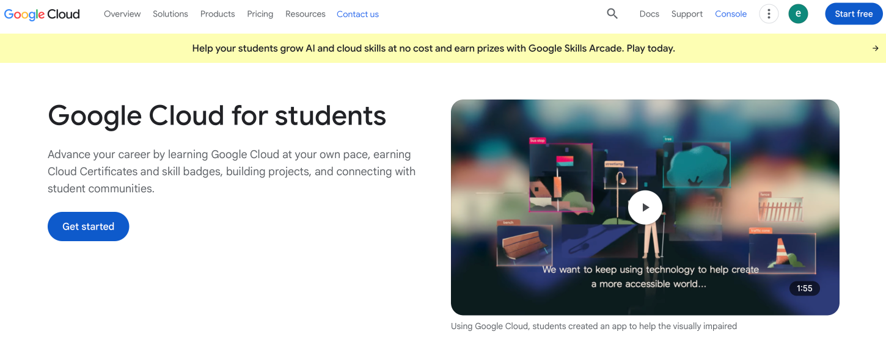
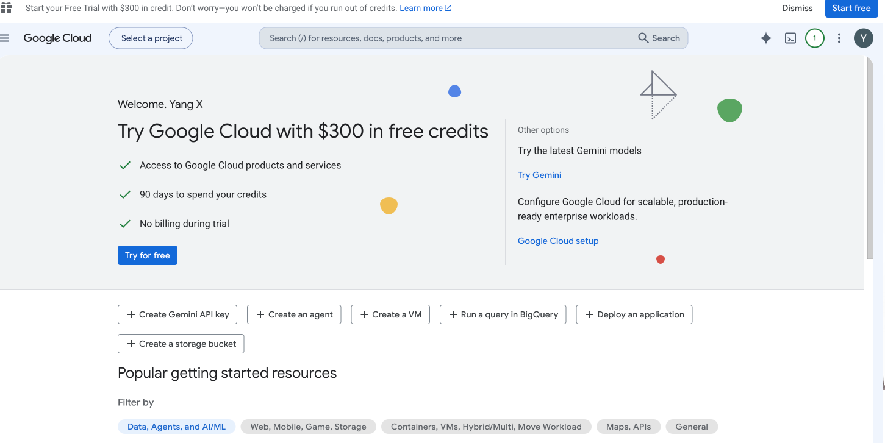
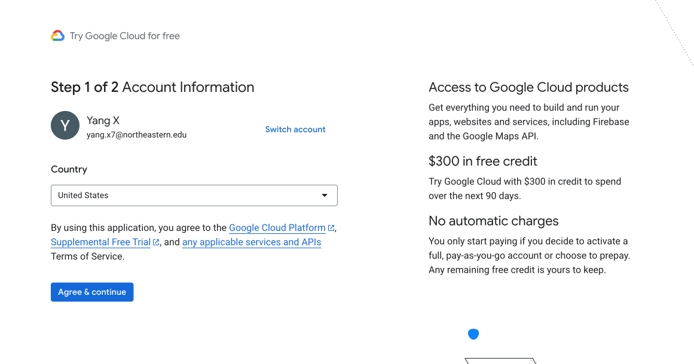
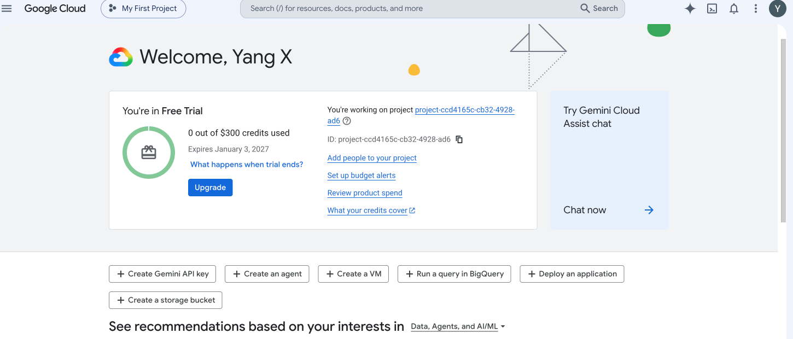
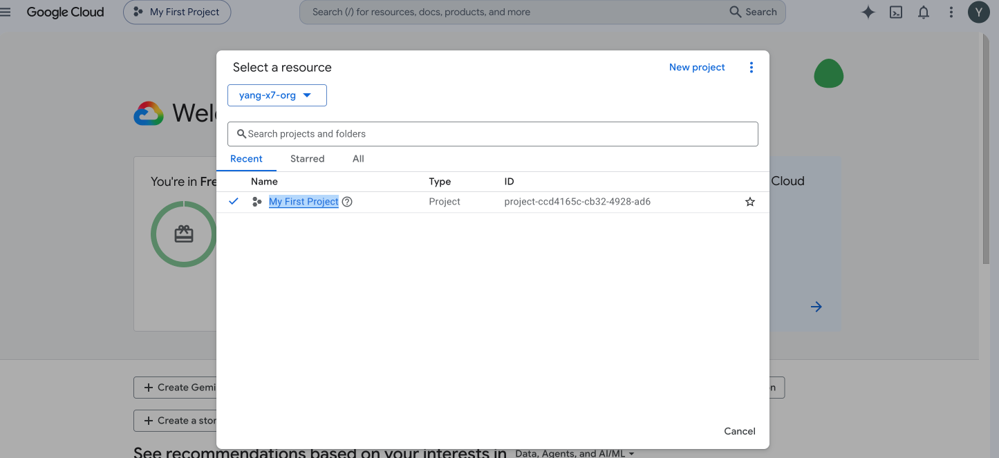

*Figure 1. Google Cloud Console showing successful access to the workshop project.*

### 2.2 Cloud Storage

We explored Google Cloud Storage, GCP's object storage service and the equivalent of Amazon S3.

We created a Cloud Storage bucket using the Standard storage class and uploaded a test text file to the bucket.

The basic procedure was:

1. Open **Cloud Storage → Buckets**.
2. Select **Create**.
3. Configure a unique bucket name and storage location.
4. Select the **Standard** storage class.
5. Create the bucket.
6. Upload a test file to the bucket.

This demonstrated how GCP stores files as objects inside cloud storage buckets.

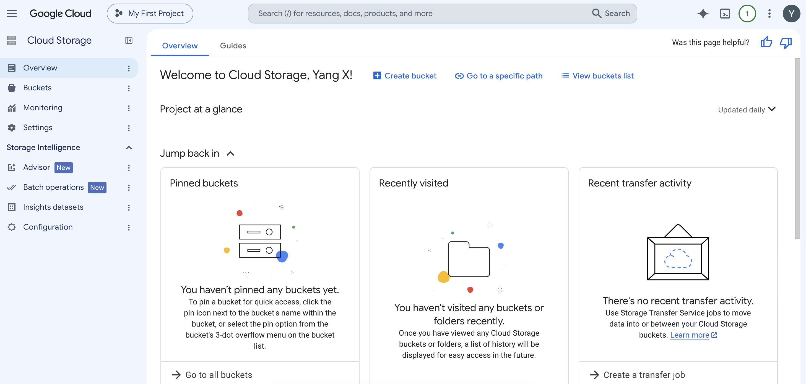
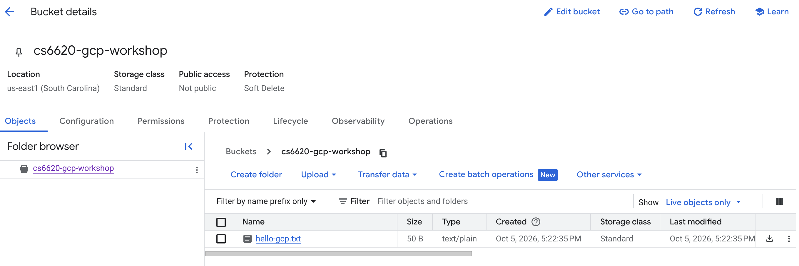

*Figure 2. A test object successfully uploaded to a Google Cloud Storage bucket.*

### 2.3 Compute Engine

We explored Google Compute Engine, which provides virtual machines and is comparable to Amazon EC2.

We created a small Linux virtual machine and connected to it through SSH directly from the Google Cloud Console.

Inside the VM, we executed the following Linux commands:

```bash
uname -a
cat /etc/os-release
hostname
```

These commands allowed us to verify the operating system and host environment running on the cloud VM.

After completing the experiment, we deleted the VM to avoid unnecessary resource usage.

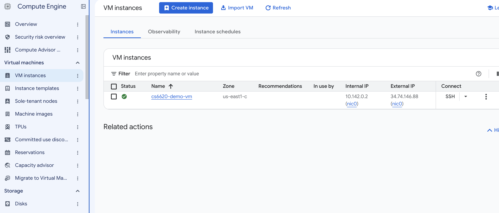
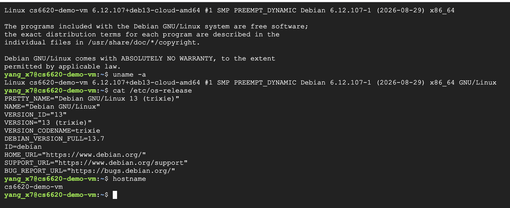

*Figure 3. Linux commands executed through an SSH connection to a Google Compute Engine VM.*

### 2.4 Networking

We examined the default Google Cloud VPC network and its regional subnets.

Each subnet has a private CIDR address range that can be used to assign internal IP addresses to cloud resources such as virtual machines.

An important difference from AWS is that a Google Cloud VPC network is a global resource, while its subnets are regional. In AWS, a VPC itself is associated with a particular region.

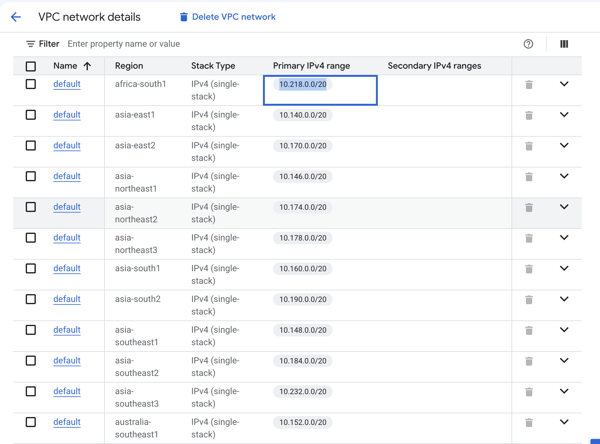

*Figure 4. The default Google Cloud VPC network and regional subnet configuration.*

### 2.5 Cloud SQL

We also explored Cloud SQL, Google's managed relational database service.

Cloud SQL supports relational database engines including:

- MySQL
- PostgreSQL
- SQL Server

It serves a similar role to Amazon RDS by allowing users to run relational databases without manually managing the underlying database server infrastructure.

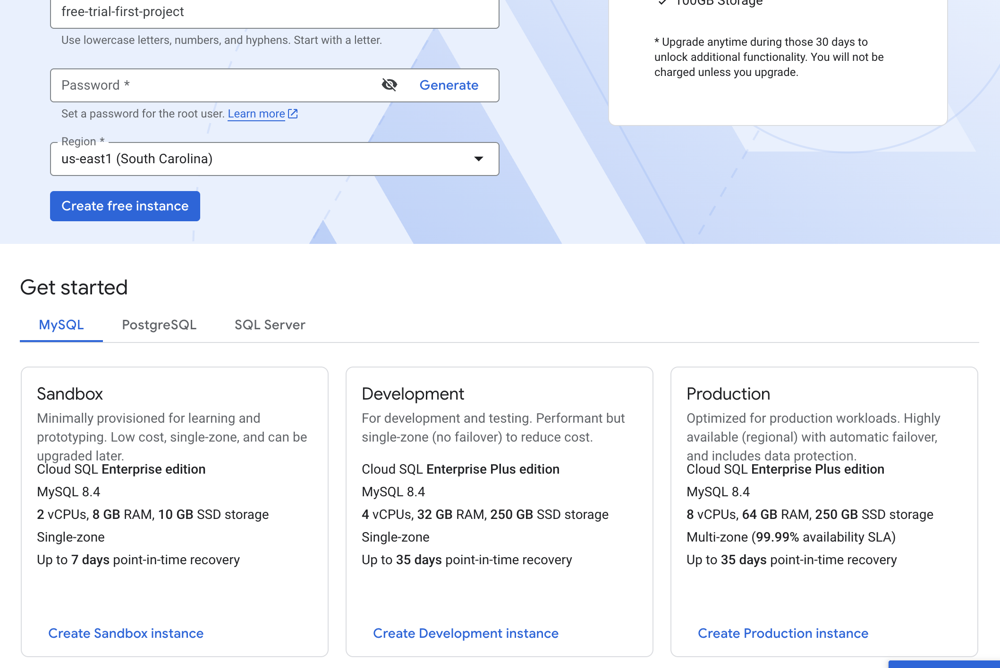


### 2.6 Vertex AI

For artificial intelligence services, we explored Vertex AI and Model Garden.

Vertex AI provides tools for generative AI, model development, training, deployment, and machine-learning workflows. Model Garden provides access to Google's models and other supported AI models.

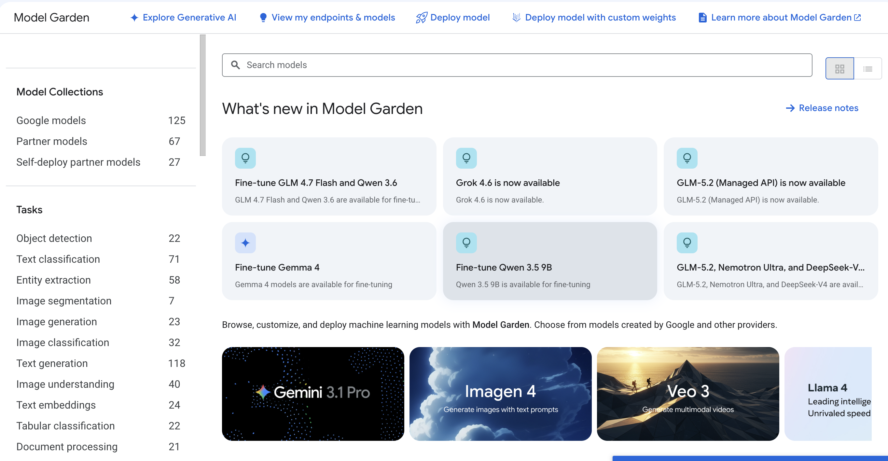

*Figure 5. Vertex AI Model Garden available through the Google Cloud Console.*

---

## 3. Proposed Hands-On Activity: Deploying an Application with Cloud Run

For the class hands-on activity, we propose deploying a containerized sample web application using **Google Cloud Run**.

Cloud Run is a managed serverless container platform. Unlike a traditional virtual machine, users do not need to manually provision or maintain a server.

Instead, a container image is deployed to Cloud Run, and Google manages the underlying infrastructure.

During our exploration, we successfully deployed a sample container to Cloud Run and accessed the application through the HTTPS URL generated by Google Cloud.

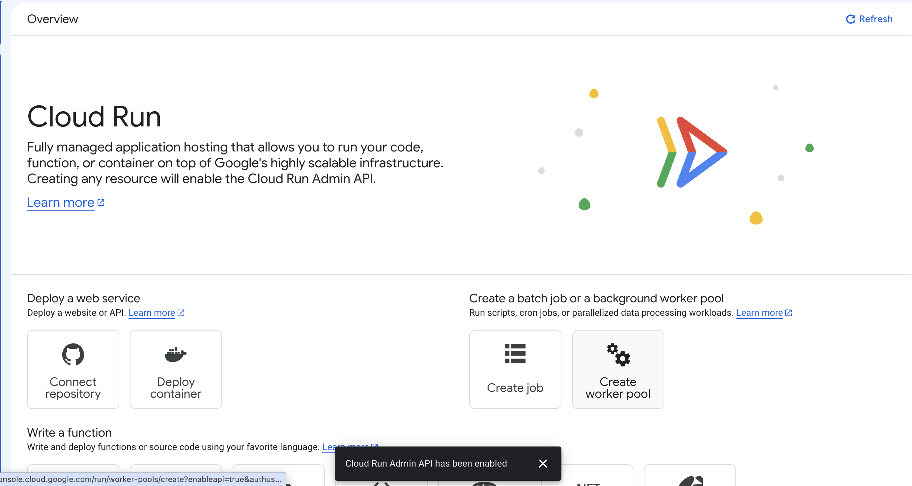
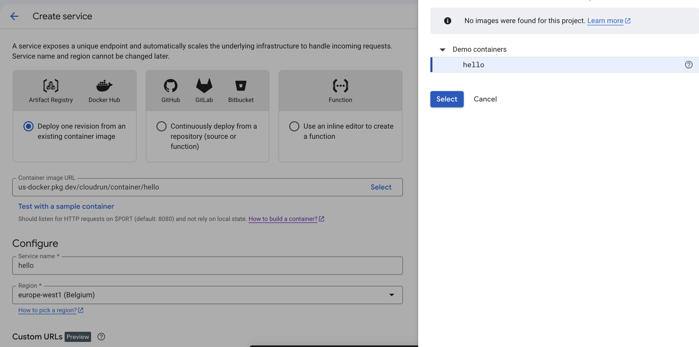
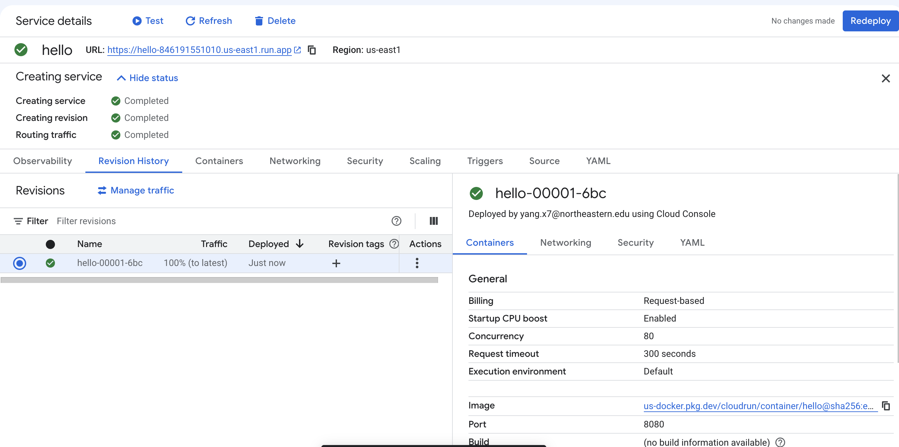

*Figure 6. Sample container successfully deployed as a Google Cloud Run service.*

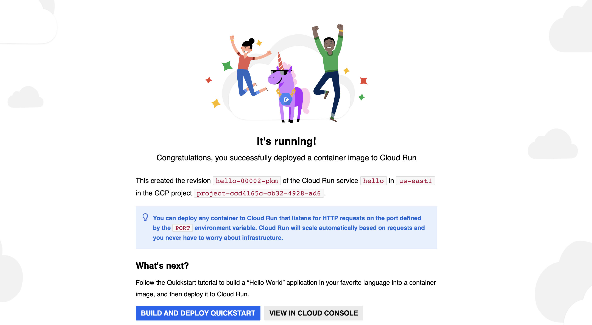

*Figure 7. The deployed application accessed through its public HTTPS endpoint.*

### Proposed 15–20 Minute Procedure

Students will:

1. Sign in to Google Cloud and select the workshop project.
2. Navigate to **Cloud Run**.
3. Create a new Cloud Run service.
4. Deploy a provided sample container image.
5. Select a deployment region.
6. Configure the service for public access for the classroom demonstration.
7. Deploy the service.
8. Open the generated HTTPS endpoint in a browser.
9. Review the service's scaling configuration.

This exercise introduces several cloud concepts at the same time:

- Containers
- Managed compute
- Application deployment
- Networking
- HTTPS endpoints
- Automatic scaling

Cloud Run can automatically adjust the number of container instances based on incoming requests. It can also scale down when there is no traffic, reducing the need to keep dedicated server capacity running continuously.

---

## 4. Questions and Areas for Further Investigation

Our initial exploration identified several areas that we would like to investigate before conducting the final workshop:

1. How does Cloud Run autoscaling behave when a service receives a sudden increase in concurrent requests?
2. What are the main cost differences between running the same application on Compute Engine and Cloud Run?
3. What authentication and IAM configuration should be used for a production Cloud Run service instead of allowing public access?
4. How can Cloud Run connect securely to other GCP services such as Cloud SQL and Cloud Storage?
5. What limitations or quotas could affect students when completing the activity using educational Google Cloud accounts?

---

## 5. Conclusion

This initial exploration demonstrated that the core cloud concepts introduced through AWS have direct counterparts in Google Cloud, although some architectural and management approaches differ.

We successfully explored Google Cloud services for compute, storage, networking, databases, AI, scalability, and application deployment.

The proposed Cloud Run activity provides a relatively simple way for students to experience container deployment, networking, managed cloud infrastructure, and automatic scaling within a 15–20 minute classroom exercise.